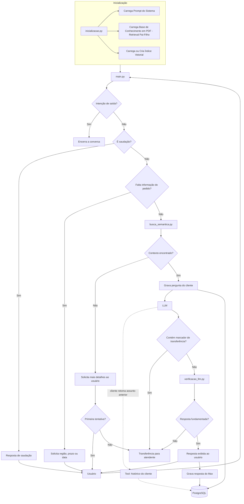

# Max - Assistente Virtual de Entregas


Projeto desenvolvido para estudo de aplicações de IA utilizando Large Language Models (LLMs), Prompt Engineering e Retrieval-Augmented Generation (RAG).

Assistente de atendimento ao cliente que responde com base nas políticas reais da empresa, transfere automaticamente para atendentes humanos quando necessário, mantém contexto durante a conversa e consulta o histórico recente do cliente quando ele retoma um assunto de uma sessão anterior.

> Além do código-fonte, este projeto documenta os experimentos realizados durante o desenvolvimento — incluindo falhas, hipóteses testadas e decisões arquiteturais recalibradas com dado real. Veja [EXPERIMENTS.md](./EXPERIMENTS.md).

## Objetivo

Desenvolver um assistente virtual de atendimento ao cliente baseado em LLMs e Retrieval-Augmented Generation (RAG), com foco não apenas em fazer o sistema funcionar, mas em entender os limites reais de cada decisão de arquitetura — calibração de parâmetros com dado real, mitigação de alucinação, trade-offs de custo e confiabilidade, e organização de código sustentável.

O projeto simula um cenário real de atendimento (a XYZ Entregas, empresa fictícia). Boa parte do valor deste repositório está no processo de investigação por trás de cada escolha técnica.

## Exemplo de conversa

**Fluxo de saudação — resposta fixa, sem custo de chamada ao modelo:**
```
Você: oii

Max: Olá! Como posso te ajudar hoje?
```

**Fluxo de informação insuficiente — antes mesmo da busca de contexto:**
```
Você: meu pedido está atrasado há 1 semana, o que eu faço?

Max: Para te ajudar melhor, preciso de mais alguns detalhes. Você pode
informar sua região e, se possível, há quantos dias fez o pedido?
```

**Fluxo padrão — pergunta de negócio com contexto encontrado:**
```
Max: Olá! Sou o Max, assistente da XYZ Entregas. Como posso ajudar?

Você: Meu pedido está constando como entregue mas não recebi nada.

Max: Entendo a situação. De acordo com nossas políticas, você deve acionar
o suporte em até 48h após a data de entrega. Abriremos uma investigação
com prazo de 3 dias úteis. Deseja prosseguir com o reenvio ou reembolso?

Você: Quero falar com um atendente.

Max: Aguarde, vou transferir para um atendente.
[Sistema]: Transferindo...
```

**Fluxo de contexto não encontrado — reformulação antes de transferir:**
```
Você: qual o horário do próximo jogo do brasileirão

Max: Não entendi muito bem sua pergunta. Você pode explicar de outra
forma, com mais detalhes sobre seu pedido?
```

## Arquitetura



## Como funciona

Antes de qualquer busca, o Max verifica se a mensagem é uma intenção de saída ou uma saudação — usando o mesmo mecanismo de embedding do RAG, mas contra bases pequenas de exemplos, sem gastar chamada ao modelo de linguagem para isso.

Em seguida, uma chamada ao LLM verifica se a pergunta já contém as informações necessárias para determinar qual regra se aplica. O dado que falta depende do assunto perguntado, não é uma regra única: para prazo de entrega, a empresa distingue entre pedido nacional e dois destinos internacionais em fase piloto (Portugal e Estados Unidos), cada um com prazo próprio; para extravio, a regra muda apenas entre nacional e internacional, o procedimento é o mesmo para os dois países cobertos. Perguntas que dependem de um dado ainda não informado — região, país de destino ou prazo — recebem um pedido de mais detalhes antes de qualquer busca, evitando gastar uma chamada de geração e uma busca vetorial em uma pergunta que já se sabe estar incompleta.

Para perguntas de negócio, o sistema gera embeddings da consulta e realiza uma busca vetorial utilizando FAISS, com um limiar de relevância mínimo (`score_threshold`). A base de conhecimento é um PDF de políticas, processado com extração estrutural via metadados de fonte (tamanho e tipografia) — reconstruindo a hierarquia de capítulos e seções do documento sem depender de convenções de formatação. O chunking segue uma estratégia de **retrieval pai-filho**: unidades pequenas (uma subseção ou linha de tabela por vez) são usadas na busca por similaridade, enquanto o conteúdo completo da seção correspondente é devolvido como contexto ao LLM — evitando tanto a diluição semântica de chunks grandes quanto a perda de contexto de chunks pequenos demais.

Se nenhum chunk for relevante o suficiente, o Max pede para o cliente reformular; se isso se repetir, a conversa é transferida para um atendente, sem gastar uma chamada de geração em uma pergunta sem contexto útil.

Quando contexto relevante é encontrado, ele é inserido no prompt enviado ao GPT-4o Mini junto com a pergunta original do cliente, permitindo respostas fundamentadas na base de conhecimento da empresa — não no conhecimento genérico do modelo — e capazes de aplicar a política correta mesmo quando mais de uma política candidata aparece no contexto. Antes de exibir a resposta, uma segunda chamada ao modelo verifica se ela usa apenas informação presente no contexto e no relato do cliente (*grounding verification*); se a resposta contiver uma inferência não fundamentada, ela é descartada e a conversa é transferida para um atendente humano, em vez de mostrada ao cliente.

O índice vetorial e os documentos-pai são persistidos em disco e só são recalculados quando a base de conhecimento (`politicas_xyz.pdf`) é alterada, evitando reprocessamento desnecessário a cada execução.

Durante a sessão, o histórico é mantido em memória e resumido automaticamente quando cresce (resumo progressivo combinado com uma janela das mensagens mais recentes), para que o contexto da conversa não aumente sem limite. A pergunta do cliente é gravada em PostgreSQL (tabelas de clientes, conversas e mensagens, via SQLAlchemy) assim que o contexto relevante é encontrado, antes da chamada ao modelo; a resposta do Max só é gravada depois de passar pelas duas checagens (marcador de transferência e grounding). Em uma transferência, portanto, só a pergunta fica registrada. Saudação, pedido de mais informação, intenção de saída e perguntas sem contexto não são gravados hoje.

Quando o cliente retoma um assunto de uma conversa anterior ("e como ficou meu problema?"), o modelo aciona, via tool calling, a tool `buscar_historico_anterior`. Ela lê as mensagens do cliente e as respostas do Max, de todas as conversas desse cliente nos últimos 30 dias, e as devolve em ordem cronológica. O limite principal é um orçamento de caracteres (6000, valor provisório), somado da mensagem mais recente para a mais antiga: a mais recente sempre entra, e o corte acontece na primeira linha que não couber. Um teto de 150 mensagens funciona como segunda proteção. O orçamento foi escolhido porque, nos dados medidos, as respostas do Max são muito mais longas que as mensagens do cliente (média de 269 contra 30 caracteres), então contar mensagens escondia o custo real.

Um eval set automatizado (`tests/`), com 30 casos, roda um conjunto de perguntas de teste contra o pipeline completo — saudação, recuperação de contexto, necessidade de informação adicional e grounding — usado para validar que mudanças no prompt, no chunking ou nos parâmetros de retrieval não introduzem regressões em comportamentos já calibrados. Além de testar cada etapa isoladamente, dois tipos de check validam propriedades do fluxo real de decisão: um confirma em qual etapa exata do pipeline uma pergunta é interceptada (garantindo, por exemplo, que uma pergunta ambígua entre nacional e internacional é barrada antes de chegar ao retriever, e não só que a função isolada retorna o valor certo); outro confirma qual política de negócio foi de fato aplicada na resposta final, não apenas que a resposta está "fundamentada" em algum contexto — uma resposta pode citar a política errada entre duas candidatas e ainda passar numa checagem de grounding ingênua. O eval set não exercita tool calling: a tool de histórico e a persistência têm testes próprios (`test_historico.py` e `test_persistencia.py`).

## Funcionalidades

- Atendimento automatizado sobre problemas de entrega
- Detecção de saudação e de intenção de saída via embedding, sem custo de chamada ao modelo
- Verificação de informação suficiente antes da busca, evitando retrieval desnecessário em perguntas incompletas — com granularidade por assunto (prazo internacional exige o país específico; extravio internacional exige apenas saber que é internacional, já que a regra é igual para os destinos cobertos)
- Respostas baseadas nas políticas da empresa via RAG, com limiar de relevância calibrado com dado real
- Extração estrutural de PDF via metadados de fonte, reconstruindo a hierarquia do documento sem valores hardcoded
- Chunking e retrieval pai-filho, com tratamento dedicado para conteúdo tabular
- Verificação de grounding: uma segunda checagem que descarta respostas não fundamentadas no contexto ou no relato do cliente
- Fallback de reformulação antes de transferir, para perguntas fora do escopo
- Transferência automática para atendente humano quando necessário
- Persistência do índice vetorial e dos documentos-pai em disco, recalculados apenas quando a base muda
- Eval set automatizado (30 casos) para validar regressões após mudanças de prompt, chunking ou verificação — incluindo checagem da ordem real de interceptação do pipeline e da política de negócio de fato aplicada na resposta
- Memória de sessão com resumo automático do histórico quando a conversa cresce
- Persistência de conversas e mensagens em PostgreSQL
- Consulta ao histórico do cliente entre sessões via tool calling, com janela de 30 dias e orçamento de caracteres
- Log técnico separado da interface do usuário

## Tecnologias

- Python 3.10+
- LangChain (core, text-splitters, community, openai)
- OpenAI API (GPT-4o Mini), incluindo tool calling
- OpenAI Embeddings
- FAISS (banco de vetores)
- PostgreSQL, SQLAlchemy e psycopg2 (persistência de clientes, conversas e mensagens)
- pdfplumber (extração estrutural de PDF)
- python-dotenv

## Estrutura do projeto

```
max-assistente/
├── data/
│   ├── politicas_xyz.pdf      # Base de conhecimento da empresa
│   ├── faiss_index/            # Índice vetorial persistido (gerado, ignorado no Git)
│   ├── faiss_metadata.txt      # Controle de atualização do índice (gerado, ignorado no Git)
│   └── parent_docstore.json    # Documentos-pai persistidos (gerado, ignorado no Git)
├── logs/
│   └── app.log                 # Log técnico separado da interface do usuário (gerado, ignorado no Git)
├── prompts/
│   └── system.txt              # Personalidade e regras do assistente
├── src/
│   ├── main.py                  # Loop de conversa
│   ├── processamento.py         # Pipeline de uma pergunta (processar_pergunta)
│   ├── inicializacao.py         # Carregamento de prompt, base de conhecimento e retriever pai-filho
│   ├── extracao_pdf.py          # Extração estrutural do PDF e chunking pai-filho
│   ├── busca_semantica.py       # Busca de contexto e detecção de saudação por embedding
│   ├── verificacao_llm.py       # Verificação de informação suficiente e de grounding
│   ├── memoria_sessao.py        # Memória da sessão e resumo automático
│   ├── db/
│   │   ├── models.py            # Modelos SQLAlchemy (Cliente, Conversa, Mensagem)
│   │   ├── schema.sql           # Script de criação das tabelas (com os CHECK constraints)
│   │   └── session.py           # Conexão com o PostgreSQL e obter_session()
│   └── tools/
│       ├── __init__.py          # Exporta a lista todas_as_tools
│       └── historico.py         # Tool de histórico entre sessões (buscar_historico_anterior)
├── tests/
│   ├── eval_set.json             # Casos de teste do eval set automatizado
│   ├── test_eval_set.py          # Script de execução do eval set contra o pipeline completo
│   ├── test_historico.py         # Testes da tool de histórico (janela, orçamento, ordem)
│   ├── test_persistencia.py      # Testes da gravação de conversas e mensagens
│   └── debug_*.py                # Scripts de diagnóstico (extração, scores, calibração, estabilidade)
├── .env.example                 # Exemplo de variáveis de ambiente
├── .gitignore
├── requirements.txt
├── EXPERIMENTS.md               # Documentação de testes e decisões técnicas
└── README.md
```

## Como rodar

1. Clone o repositório
```bash
git clone https://github.com/igormuccio/max-assistente.git
cd max-assistente
```

2. Crie e ative o ambiente virtual
```bash
python -m venv .venv
.venv\Scripts\Activate.ps1  # Windows
source .venv/bin/activate   # Linux/Mac
```

3. Instale as dependências
```bash
pip install -r requirements.txt
```

4. Prepare o PostgreSQL

O Max grava clientes, conversas e mensagens em um banco PostgreSQL chamado `max_db`. A conexão usa o usuário `postgres` em `localhost:5432` (definida em `src/db/session.py`). Crie o banco e as tabelas a partir do script do projeto:
```bash
psql -U postgres -h localhost -c "CREATE DATABASE max_db;"
psql -U postgres -h localhost -d max_db -f src/db/schema.sql
```

5. Configure as variáveis de ambiente
```bash
cp .env.example .env
# Preencha OPENAI_API_KEY e DB_PASSWORD (senha do usuário postgres) no arquivo .env
```

6. Execute o programa
```bash
python src/main.py
```

7. (Opcional) Rode os testes
```bash
python tests/test_eval_set.py
python tests/test_historico.py
python tests/test_persistencia.py
```

Os testes de histórico e de persistência usam o banco real e deixam clientes de teste acumulando no `max_db`.

## O que este projeto explora

- Prompt engineering para controle de comportamento, incluindo marcadores de controle, mitigação de regras concorrentes e coordenação entre o prompt de geração e os prompts de verificação
- Pipeline RAG completo: chunking calibrado por seção, embeddings, busca vetorial com FAISS, limiar de relevância
- Extração estrutural de documentos não estruturados (PDF), via metadados de fonte, e retrieval pai-filho como estratégia de chunking em duas granularidades
- Ambiguidade semântica entre políticas de negócio próximas, e técnicas de chunk enrichment para separá-las
- Detecção de alucinação e verificação de grounding como camada de segurança
- Trade-offs de custo vs. confiabilidade na escolha de modelo e arquitetura
- Persistência de índice vetorial e separação de logs técnicos
- Memória em duas camadas: resumo automático dentro da sessão e consulta ao histórico entre sessões via tool calling, com o limite de contexto definido por orçamento de caracteres a partir de dado medido, e não por contagem de mensagens
- Persistência relacional (PostgreSQL e SQLAlchemy) como base da memória entre sessões
- Eval set automatizado para prevenir regressões entre camadas de retrieval, prompt e verificação, incluindo checagem da ordem real de execução do pipeline e da política de negócio de fato aplicada, não apenas de cada função isolada
- Decisões de escopo fundamentadas em evidência empírica — incluindo o descarte, com teste real e não apenas leitura teórica, de técnicas que pareciam fazer sentido na teoria mas não encontraram cenário de aplicação real na arquitetura atual (query rewriting, HyDE, structured output e MCP), e a análise de por que agents não se encaixam em um workflow determinístico como o do Max
- Organização de projeto em módulos por responsabilidade

Cada uma dessas decisões foi testada empiricamente, não apenas assumida — incluindo casos em que a primeira solução falhou e precisou ser recalibrada. Para o histórico completo de testes, hipóteses e limitações conhecidas, veja [EXPERIMENTS.md](./EXPERIMENTS.md).

## Melhorias futuras

- Ampliar o eval set com mais variações de pergunta (específica, difusa, fora do domínio) — crescimento orgânico conforme novos casos surgirem em teste, não um lote isolado
- Detecção de mensagens fragmentadas ou incompletas (cliente digitando em várias mensagens curtas em sequência) — adiada por ora; não builda em cima de nenhuma outra etapa do pipeline, então fica reservada para quando o projeto migrar de configuração de estudo para uma configuração voltada a apresentação
- Persistência das interações que hoje não são gravadas (saudação, pedido de mais informação, intenção de saída e perguntas sem contexto), para o histórico entre sessões ficar completo
- Calibração do orçamento de histórico em tokens (tiktoken) com dados reais, no lugar do valor provisório de 6000 caracteres
- Migração do índice vetorial de FAISS para pgvector, a ser tratada após o deploy — exigiria recalibrar o `score_threshold` e rodar o eval set novamente
- Interface Web com Streamlit, com hospedagem gratuita no Streamlit Community Cloud
- API REST utilizando FastAPI — a decisão entre uma API separada ou tudo no Streamlit será tomada na abertura da fase de deploy
- Docker para facilitar o deploy
- Observabilidade e tracing (LangSmith)

> Query rewriting e HyDE (Seções 18 e 19 do [EXPERIMENTS.md](./EXPERIMENTS.md)) e MCP (Seção 26) foram avaliados com teste real e **descartados** como funcionalidades de produção, não permanecem como melhoria futura — o código desses experimentos fica preservado em branches separadas como evidência reproduzível, sem integração no fluxo principal. Structured output foi implementado e revertido (Seção 25), e agents não se encaixam em um workflow determinístico como o do Max (Seção 26).

## Observações

As políticas presentes em `data/politicas_xyz.pdf` são fictícias e utilizadas apenas para fins de demonstração.
